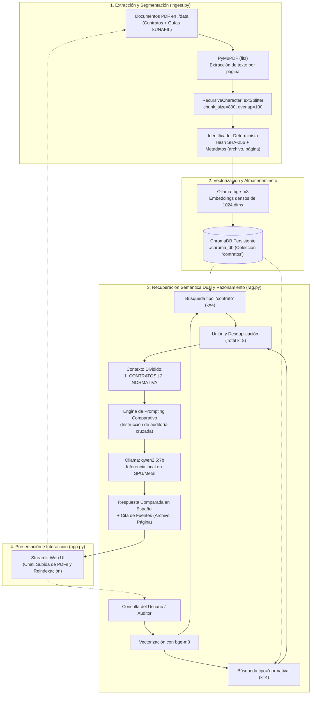

# Guía Técnica de Implementación y Ejecución RAG

Este documento detalla la arquitectura técnica, las decisiones de diseño de ingeniería, los requisitos del sistema y el paso a paso exacto para desplegar y operar el sistema RAG local de contratos laborales y normativa SUNAFIL/MTPE.

---

## 1. Arquitectura del Pipeline RAG

El sistema sigue una arquitectura desacoplada en tres capas principales:



---

## 2. Decisiones de Ingeniería y Selección de Modelos

| Componente | Tecnología Seleccionada | Justificación Técnica |
| :--- | :--- | :--- |
| **Lector de PDFs** | **PyMuPDF (`fitz`)** | Hasta **10 veces más rápido** que PyPDF o PDFMiner. Respeta el flujo de texto nativo, no altera los saltos de línea y extrae fielmente el número de página para la trazabilidad legal. |
| **Segmentación** | **`langchain-text-splitters`** | Segmentación recursiva con separadores jerárquicos (`\n\n`, `\n`, `. `, ` `). Un tamaño de **800 caracteres con 100 de solapamiento** preserva cláusulas completas sin cortar cifras salariales ni artículos legales. |
| **Embeddings** | **BAAI `bge-m3`** (vía Ollama) | Modelo SOTA (State of the Art) multilingüe de 1024 dimensiones. Sobresale en español formal, terminología jurídica y similitud semántica cruzada (código laboral vs. contrato individual). |
| **Base Vectorial** | **ChromaDB** (Persistente) | Base de datos embebida en SQLite y HNSW sin necesidad de servidores externos (como Pinecone o Weaviate). Cero dependencias de red y almacenamiento 100% local en `./chroma_db`. |
| **Modelo LLM** | **`qwen2.5:7b`** (vía Ollama) | Modelo de 7 mil millones de parámetros con excepcional capacidad de razonamiento lógico, seguimiento estricto de instrucciones y fluidez nativa en español. Supera ampliamente a Llama 3 8B en síntesis de documentos extensos. |
| **Aceleración** | **Apple Silicon (Metal API)** | En procesadores M-series de Mac (M1, M2, M3, M4, M5), Ollama compila con soporte de aceleración gráfica Metal y Memoria Unificada (UMA), permitiendo inferencia casi instantánea (30+ tokens/segundo). |

---

## 3. Prevención de Duplicados e Idempotencia

En un entorno corporativo, la ingesta de documentos se ejecuta de manera periódica. Para evitar duplicar vectores en ChromaDB, `ingest.py` implementa un identificador único determinista para cada fragmento:

$$\text{Chunk ID} = \text{archivo} + \text{"\_p"} + \text{página} + \text{"\_c"} + \text{índice} + \text{"\_x"} + \text{SHA256}(\text{contenido})[:12]$$


Al ejecutarse la ingesta:
1. Se extraen los IDs existentes en ChromaDB mediante `collection.get()`.
2. Se evalúan los fragmentos de los PDFs en `./data`.
3. Si un ID ya existe, **se omite el cálculo de embedding**, ahorrando tiempo de procesamiento y consumo de energía.
4. La inserción se realiza mediante `collection.upsert()`, garantizando idempotencia total.

---

## 4. Guía de Ejecución Paso a Paso

### Prerrequisitos
- Python 3.11 instalado en el sistema.
- Ollama instalado y en ejecución (`ollama serve`).

### Paso 1: Activar el entorno virtual
Desde la carpeta raíz del proyecto:
```bash
cd lector-doc-rag
source venv/bin/activate
```
*(Si no creaste el entorno virtual previamente, créalo con: `python3.11 -m venv venv && source venv/bin/activate && pip install -r requirements.txt`)*

### Paso 2: Verificar modelos en Ollama
Asegúrate de haber descargado los pesos de los dos modelos locales:
```bash
ollama pull bge-m3
ollama pull qwen2.5:7b
```

### Paso 3: Generar o actualizar los documentos PDF
Para generar la suite completa de contratos en Soles (S/.) y las guías de SUNAFIL/MTPE:
```bash
python generate_sample_contracts.py
```

### Paso 4: Ejecutar la Ingesta e Indexación en ChromaDB
Para procesar los PDFs y crear la base vectorial persistente:
```bash
python ingest.py --reset
```
*El parámetro `--reset` limpia la colección previa y garantiza una indexación limpia de todos los documentos.*

### Paso 5: Pruebas por Consola (CLI)
Puedes validar consultas directamente desde la terminal:
```bash
python rag.py "¿El periodo de prueba de Ana Torres cumple con la normativa de SUNAFIL?"
```

### Paso 6: Lanzar la Interfaz Gráfica Web
Inicia la aplicación interactiva de Streamlit:
```bash
streamlit run app.py
```
Abre en tu navegador: **`http://localhost:8501`**

---

## 📂 5. Estructura de Archivos del Proyecto

```text
lector_doc_rag/
├── data/                                             # Repositorio de documentos PDF
│   ├── contrato_indefinido_ana_torres.pdf            # Contrato laboral Tech Lead (S/ 14,500)
│   ├── contrato_plazo_fijo_miguel_quispe.pdf         # Contrato Senior Data Engineer (S/ 9,800)
│   ├── contrato_formativo_lucia_robles.pdf           # Convenio de Prácticas SOC (S/ 2,400)
│   ├── contrato_especialista_ai_carlos_mendoza.pdf   # Contrato AI Engineer (S/ 12,000)
│   ├── manual_politicas_rrhh_2026.pdf                # Manual interno de licencias y horarios
│   ├── guia_oficial_derechos_laborales_sunafil_mtpe.pdf # Normativa general laboral (D.S. 003-97-TR)
│   ├── compendio_normativo_ley_teletrabajo_31572_sunafil.pdf # Ley de Teletrabajo y Desconexión
│   └── guia_modalidades_formativas_practicas_ley_28518.pdf   # Ley de Modalidades Formativas
├── chroma_db/                                        # Almacenamiento vectorial embebido local
├── ingest.py                                         # Pipeline de extracción, chunking e indexación
├── rag.py                                            # Motor de recuperación semántica e inferencia LLM
├── app.py                                            # Interfaz de usuario interactiva en Streamlit
├── generate_sample_contracts.py                      # Generador autónomo de contratos y normativas PDF
├── requirements.txt                                  # Dependencias fijadas para Python 3.11
├── .gitignore                                        # Reglas de exclusión para venv, chroma y PDFs
├── IMPLEMENTACION_RAG.md                             # Guía técnica profunda de implementación (este archivo)
└── README.md                                         # Documentación ejecutiva del proyecto
```

---

## ⚙️ 6. Parámetros de Configuración Modificables

Los siguientes parámetros pueden ajustarse en `ingest.py` y `rag.py` según la memoria y recursos de la máquina:

| Parámetro | Archivo | Valor Actual | Impacto |
| :--- | :--- | :--- | :--- |
| `CHUNK_SIZE` | `ingest.py` | `800` caracteres | Tamaño de cada fragmento textual base. |
| `CHUNK_OVERLAP` | `ingest.py` | `100` caracteres | Solapamiento para no cortar cláusulas o artículos contiguos. |
| **Encabezado Contextual** | `ingest.py` | `Documento: {archivo} \| Página: {pagina}\n` | Antepuesto a cada fragmento antes de vectorizar para enriquecer el embedding. |
| **Metadato de Clasificación** | `ingest.py` | `tipo`: `contrato` \| `normativa` | Clasifica automáticamente los documentos para permitir búsquedas filtradas. |
| **Búsqueda Dual (k=8)** | `rag.py` | 4 contratos + 4 normativas | Recupera de forma balanceada tanto el contrato como la norma gubernamental con filtro `where`. |
| `temperature` | `rag.py` | `0.1` | Nivel de estocasticidad del LLM para garantizar máxima precisión y cero alucinaciones. |

---

[⬅️ Volver a la Presentación Ejecutiva en README.md](README.md)

